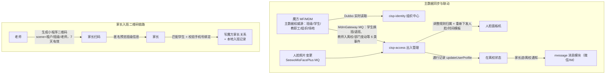
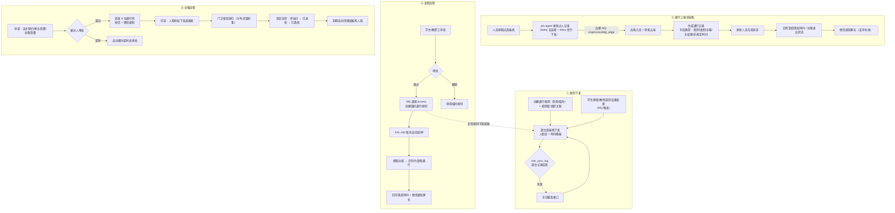
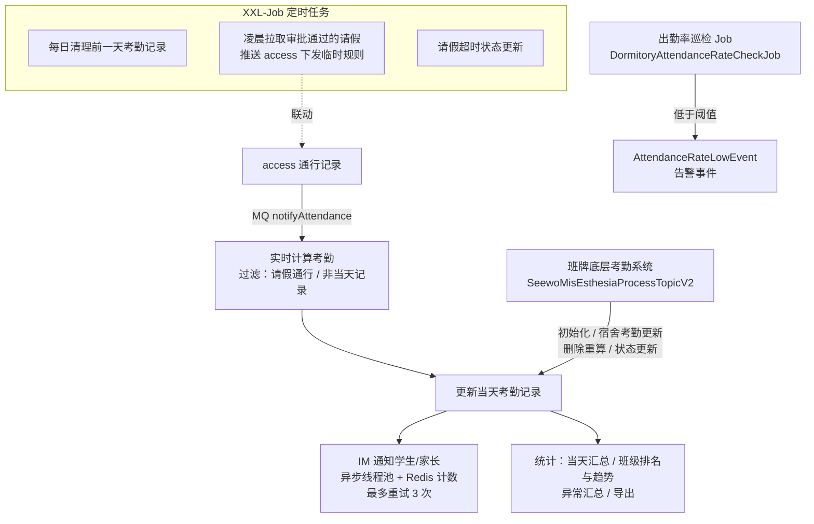
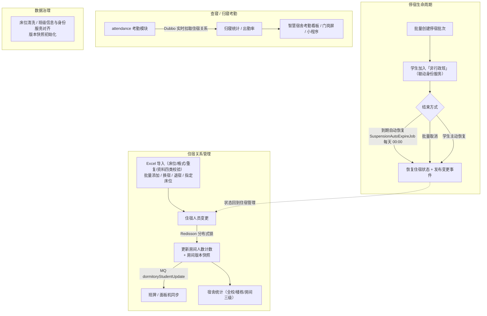
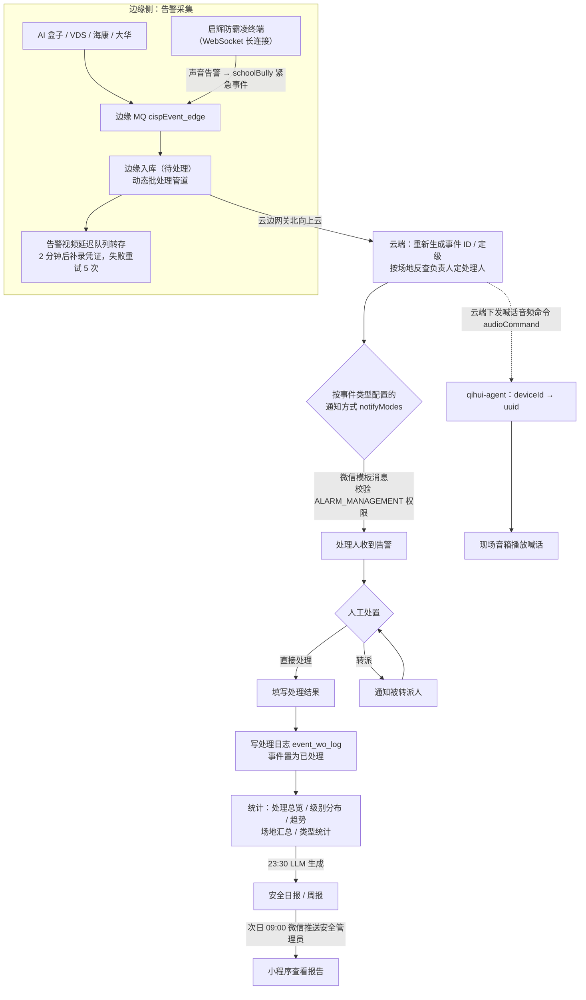

# 校园安防冒烟测试自动化计划

## **一、核心的业务功能**

### 1\.1 核心功能

| **功能模块**             | **核心功能点**                                                                               | **业务链路**                                                                                                                                                                                                                                                                                                                                                                                                                                                                     |
| -------------------- | --------------------------------------------------------------------------------------- | ---------------------------------------------------------------------------------------------------------------------------------------------------------------------------------------------------------------------------------------------------------------------------------------------------------------------------------------------------------------------------------------------------------------------------------------------------------------------------- |
| **组织中心\-基础数据管理**  | 1. 班级学生 2. 教职工管理 3. 职务与权限 4. 课表管理 5. 校园通行证 6. 场地管理 7. 学科管理 8. 学期管理 | 1. **主数据以「魔方（MF/MDM）」为权威源**：班级/学生/教职工/组织/场地经 Dubbo 实时读取 2. **变更同步（RocketMQ）**：topic MdmGateway（学生换班/退班、教师入/离校、教师部门变动等 6 类事件）→ cisp\\\-access 调整通行规则归属并重新下发人脸/时间模板 3. **人脸变更**：SeewoMisFacePlus userPhotoChangeResult → 下载图片 → 下发面板机 4. **登录认证走希沃 UC 用户中心**；小程序绑定 openid 5. **家长入班**：老师生成小程序二维码（scene=租户/班级/老师，7 天有效）→ 家长扫码匿名预览班级 → 匹配学生 → 校验手机号绑定 → 写魔方家长关系\+本地入班记录 6. **在离校状态**：随通行记录自动变更，支持批量手工修改并留修改日志                                                     |
| **校园通行管理**        | 1. 通行规则设置 2. 通行记录 3. 数据统计 4. 请假流程 5. 访客流程                                   | 1. **规则下发**：创建通行规则（常规/临时）→ 逐台面板机下发人脸库\+时间模板（明细、 记录每台成败）→ 失败可重发；学生换班/教师调岗/设备变更触发重下发 2. **通行上报**：面板机过人 → pts\\\-agent（Netty 长连接）→ 边缘 MQ → 入边缘库并转发云端 → 生成通行记录 → 更新在离校状态 → 回写请假离校时间/访客进出状态 → 按开关微信通知家长（支持补发） 3. **请假**：学生/教职工申请 → 审批 → 通过后 MQ 通知 access 创建临时通行规则 → XXL\\\-Job 按天自动启停 → 刷脸出校识别为「请假通行」→ 回写离校时间 → 微信通知家长；撤销请假停用规则 4. **访客**：申请（自主预约/家长受邀/访客受邀）→ 被访人审批（超时自动流转）→ 6 位通行码短信\+微信通知、可选人脸授权 → 门卫核验放行（分布式锁防重）→ 状态流转 → 到期自动清理人脸 5. **通行统计**：按日汇总、趋势、导出 Excel  |
| **考勤管理**          | 1. 考勤规则 2. 考勤记录 3. 修改记录 4. 数据统计                                                | 1. **实时考勤**：access 通行记录 → MQ（notifyAttendance）→ 实时计算（请假通行丢弃、非当天丢弃）→ 更新当天记录 → IM 通知学生/家长（异步线程池\+Redis 计数，最多重试 3 次）\<br\> 2. **班牌底层数据同步**：SeewoMisEsthesiaProcessTopicV2 四类消息（初始化/宿舍考勤更新/删除重算/状态更新） 3. **归寝考勤**：实时统计 \+ 出勤率巡检 Job（低于阈值发 AttendanceRateLowEvent 告警） 4. **XXL\\\-Job**：每日清理前一天记录、凌晨拉取当天审批通过的请假推送 access 下发临时规则、请假超时状态更新 5. **统计**：当天汇总（一规则一汇总）、班级排名/趋势、异常汇总、导出                                                                                       |
| **宿舍管理**          | 1. 宿舍信息管理 2. 宿舍考勤记录 3. 停宿管理 4. 宿舍查寝                                            | 1. **数据模型**：楼栋房间来自魔方，住宿关系本地维护（Excel 导入含四类校验/批量添加/换宿/退宿/指定床位） 2. **人员变更**（入住/换宿/退宿）→ Redisson 分布式锁更新房间人数 \+ 房间版本快照（dormitory\\\_student\\\_version）→ 发 MQ dormitoryStudentUpdate 供班牌/面板机同步 3. **停宿**：批量创建停宿批次 → 学生加入「非行政班」→ 到期 SuspensionAutoExpireJob（每天 00:00）自动恢复；支持批量取消/学生主动恢复 4. **查寝/归寝**：attendance 通过 Dubbo 实时拉取住宿关系计算归寝，宿舍看板/小程序展示 5. \.**数据治理**：床位清洗、班级信息与身份服务对齐、版本快照初始化                                                                                |
| **告警管理**          | 1. 告警策略 2. 告警事件 3. 告警类型 4. 防欺凌功能                                               | 1. **采集**：AI 盒子/VDS/海康/大华/启辉防霸凌终端 → 边缘 MQ（cispEvent\\\_edge）→ 边缘入库（待处理，动态批处理管道）\+ 告警视频延迟队列转存（2 分钟）→ 云边网关北向上云 → 云端重新生成事件 ID/定级、按场地定处理人 2. **通知**：按事件类型配置的 notifyModes 分发 → 微信模板消息（ALARM\\\_MANAGEMENT 权限过滤）；紧急\+短信模式记录被通知人手机号（外呼由外部系统承接） 3. **处理闭环**：直接处理/转派 → 写处理日志 event\\\_wo\\\_log、转派再通知 → 已处理 4. **统计与报告**：处理总览/级别分布/趋势/场地汇总/类型统计；安全日报/周报（23:30 LLM 生成，09:00 微信推送安全管理员 5. **防欺凌**：启辉 WebSocket 声音告警 → schoolBully 紧急事件（音频凭证）→ 云端下发喊话音频命令（audioCommand）      |
| **人员寻踪**             | 1. 人员轨迹查找 2. 自动寻踪                                                                    | 1. **采集**：摄像头接入 VDS 智能分析终端（4 类任务：人脸视频流/结构化视频流/行为分析/图片流），抓拍与结构化数据存边缘 VDS（敏感数据不出校），平台不落库存轨迹（落库代码已注释） 2. **人工轨迹查找**：上传照片/勾选特征（性别、上衣颜色等）\+ 时间/设备范围 → VDS 图搜（人脸/人体），图片先过 vdsRecognize 校验，结果经 /cds 代理展示 3. **自动寻踪**：只给 userId → 自动取证件照\+2 张门禁采集照共 3 张图分别人脸检索 → 取最高相似度再人体检索 → 并入门禁通行记录 → 去重（时间\+设备）、按相似度/时间排序分页 4. **AI 查轨迹**：自然语言 → /trace/ai（意图识别\+特征提取\+时间解析并行，双 LLM：希沃 AI 开放平台/火山引擎，Prompt 存 SysConfig）→ 结构化特征 → 轨迹查询 5. 云端部署时轨迹返回 mockTraceData 演示数据 \+ 真实门禁记录合并   |

### 1\.2 核心业务链路流程图

#### 组织中心\-基础数据管理

#### 校园通行管理

#### **考勤管理**

#### **宿舍管理**

#### **告警管理**

# 
