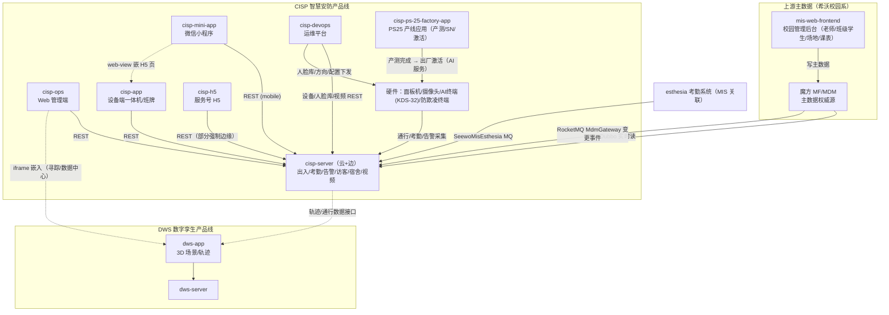

# 校园安防相关项目总览（10 项目）

## 一、项目总览

| 项目                         | 端                  | 说明                                                                                                             | 技术栈                                                                                                                                   | 部署形态                                                                       | 调用链                                                                                                                                                      |
| -------------------------- | ------------------ | -------------------------------------------------------------------------------------------------------------- | ------------------------------------------------------------------------------------------------------------------------------------- | -------------------------------------------------------------------------- | -------------------------------------------------------------------------------------------------------------------------------------------------------- |
| **mis-web-frontend**       | Web 管理端（校园 MIS，上游） | 希沃「校园」管理后台：老师管理、班级学生、校园通行证、场地管理、课表管理、考勤设置（esthesia）、权限管理、课程库、微信统计；**CISP 组织中心主数据的源头系统**                        | React 16.8 + Antd 3 + Redux/MobX + react-router 5 + Webpack(dll) + qiankun 微前端 + kraken-react 脚手架；自带 Node 服务（multer/redis）            | 希沃侧环境（`campus-*.test.seewo.com`），作为统一登录与基础服务 header 宿主                     | 下行写**魔方云 MF/MDM**（主数据权威源）；为校园系子系统提供 `loginApi()`/`insertManageHeader()` 壳服务；主数据经 Dubbo/RocketMQ 供给 cisp-server                                           |
| **cisp-server**            | 后端                 | 校园智能安防平台后端：出入/考勤/宿舍/告警事件/访客/设备/视频/消息/统计模块 + 云边通信网关                                                             | Java 8 + Kotlin 1.9 + Spring Boot + Maven 多模块（mixin 组装）+ MySQL + RocketMQ + Dubbo                                                     | 鲸云容器，云端 + 校园边缘服务器双部署                                                       | 上行服务 cisp-ops / cisp-app / cisp-mini-app / cisp-h5 / cisp-devops；下行经 pts-agent（Netty）管面板机、WebSocket 对接防欺凌终端、GBS 取流；上游 Dubbo 读魔方主数据 + `MdmGateway` MQ 收变更 |
| **cisp-ops**               | Web 管理端            | 智慧安防综合管理平台（业务管理台）：工作台、告警、出入、考勤、请假、访客、宿舍、设备、视频、校园寻踪                                                             | React 18 + Antd 5 + TS + MobX + React Query 4 + Webpack 5 + ECharts；权限码路由/按钮鉴权                                                        | 云端（`af.test.kindlink.com.cn`）+ 边缘部署；另有 cisp-ops-pro 演示版                    | → cisp-server（云/边双通道）；iframe 嵌 dws-app（人员寻踪 3D/数据中心）；跳转 H5 寻踪/事件详情                                                                                       |
| **cisp-app**               | 设备端                | 电子班牌/信息发布屏内嵌应用：门岗/宿管/考勤一体机 + 设备初始化 + 被嵌 H5（事件凭证页）                                                              | React 17（锁版本）+ Antd 3（锁版本）+ TS + MobX + Webpack 5；1920px pxtorem 适配；兼容 Chrome 55+                                                     | 云端发布（`af-app.kindlink.com.cn`），设备内置浏览器加载                                   | → cisp-server（云/边）；被 cisp-mini-app 以 web-view 嵌入；门岗一体机承担访客核验                                                                                             |
| **cisp-mini-app**          | 移动端小程序             | 开得联掌上校园微信原生小程序：教师/家长/访客三角色，考勤/请假/审批/事件/巡检/访客/人脸/在校统计/报表                                                        | 原生小程序 + TS(strict) + TDesign + WeUI + Skyline 渲染 + dayjs；分包加载                                                                         | 微信平台审核发布（appid wxdae944a8a2c46228）                                         | → cisp-server（`/cisp/mobile/*` + DWS 权限/巡检域）；web-view 嵌 cisp-app H5；接收微信模板消息与服务号推送                                                                       |
| **cisp-h5**                | 移动端 H5             | 掌上校园服务号网页（免安装通道）：人员寻踪/自动寻踪/安全告警/防欺凌录音喊话/学生通行                                                                   | Taro 4 + React 18 + TDesign Mobile + MobX + Webpack5(内置)；375px 适配；兼容三大系微信 WebView                                                     | 云端发布（`af-h5.kindlink.com.cn`），微信服务号菜单进入                                    | → cisp-server（部分接口强制走边缘内网）；接收服务号推送与 IM 实时推送（自动寻踪）                                                                                                        |
| **cisp-devops**            | Web 运维端            | CISP 运维管理平台：摄像头/门禁面板机/智能分析终端/智慧门牌/信息屏/防欺凌设备管理，人脸库同步与失败明细，AI 服务激活，平台级联                                          | React 19 + Vite 8 + TS + Tailwind 4 + Antd 6 + shadcn/radix-ui + MobX + React Query 5 + Biome + MSW + pnpm/Node 22                    | 云端（`af-devops`）+ 校园边缘服务器（`172.20.123.229/224/cisp/devops`）                 | → cisp-server 设备域接口（`/cisp/device/*`、`/cisp/userface/*`、`/cisp/video/*`）；下行下发面板机人脸库/方向/配置                                                                |
| **cisp-ps-25-factory-app** | 设备端（产线工具）          | **PS25/KDS-32 智能分析终端的出厂应用**（用于设备生产、交付、送检）：产线产测（老化/按键/算力/磁盘/风扇/HDMI/指示灯/网口/网络/USB）、SN 录入、AI 服务激活、恢复出厂、磁盘检查、演示模式 | Electron 25 + Vite 4 + React 18 + TS + MobX 6 + Antd 5 + React Router 6（Hash）+ NestJS 11 内嵌本地服务（可选）+ WebSocket IM；electron-builder 打包 | 打包 **Linux AppImage** 上传 GitLab Package Registry / CDN，随 PS25 硬件出厂刷入设备本机运行 | 运行于 PS25 设备本机（四进程：main/preload/renderer/nest-server）；对接产线与边缘内网（`VITE_API_BASE_URL`）；AI 激活能力与 cisp-devops「KDS-32 AI 服务激活」闭环衔接；IM WebSocket 对接平台推送         |
| **dws-app**                | Web 展示端            | 数字孪生校园项目运行/预览端（dws-editor 导出 → dws-ops 导入 → dws-app 预览）：2D/3D 场景、轨迹回放                                          | React 18 + Antd 5 + Webpack 5 + `@cvte/kdl-gis3d`（3D）+ `@enow3/enow`（2D）；预览内核 dwsPreviewCore 经 git subtree 共享；支持代码加密构建                | 云端 + 鲸云边缘集群                                                                | → dws-server；**被 cisp-ops 以 iframe 嵌入**（人员寻踪/数据中心）；经 GBS 拉摄像头视频流（`@cvte/cisp-player` 共享播放器）                                                              |
| **dws-server**             | 后端                 | 数字孪生后端：孪生体/分类标签/3D 模型资产（切片/点云/GIS 瓦片）/项目与漫游路线/迁移导入导出/身份认证/边缘配置                                                 | Java 8 + Spring Boot + kish framework + Maven mixin 架构 + MyBatis + MySQL                                                              | 云端 + 鲸云边缘集群                                                                | 服务 dws-editor / dws-ops / dws-app 三件套；对接 CStore 对象存储、GBS 流媒体（GB28181 取流供孪生场景播放）                                                                          |

---

## 二、相互关系

### 2.1 全景关系图

### 2.2 四条关键关系

**① 主数据上下游（mis-web-frontend → cisp-server）**

mis-web-frontend 是整条链的第一环：管理员维护的老师/班级学生/场地数据写入魔方 MF/MDM，CISP 通过 **Dubbo 实时读取 + RocketMQ `MdmGateway` 变更事件**消费——学生换班、教师入离校会自动触发 cisp-access 调整通行规则归属并重新下发人脸/时间模板。管理端里的「校园通行证」「考勤设置（esthesia）」也与 CISP 通行、考勤链路直接对应。

**② CISP 内部“一脑四脸一管家”**

- **一脑**：cisp-server 是唯一业务数据源，所有端共用
- **四脸**（按使用者分流）：管理员 → cisp-ops；门卫/宿管/现场 → cisp-app（一体机/班牌）；教师/家长 → cisp-mini-app 与 cisp-h5（双通道冗余，功能有意重叠）；每张脸各管发起、查看与处理
- **一管家**：cisp-devops 不承载业务，专管设备生命周期（接入、方向配置、人脸库下发、AI 激活），保障“四张脸”有数据可展示；设备生命周期的**最前端**由 cisp-ps-25-factory-app 承担——PS25/KDS-32 硬件在产线完成产测、SN 录入与出厂激活后，才进入 cisp-devops 的运维视野

**③ DWS 与 CISP 的三个交叉点**

1. **iframe 嵌入**：cisp-ops「人员寻踪/数据中心」嵌 dws-app，CISP 出数据、DWS 出 3D 校园
2. **共享组件**：`@cvte/cisp-player` 播放器同时存在于 cisp-ops/cisp-app/cisp-h5/dws-app
3. **同源视频**：dws-server 的 GBS（GB28181）取流与 CISP 视频模块指向同一批校园摄像头

**④ 工程范式同源、技术栈三代并存**

- cisp-server 与 dws-server 使用**完全相同的工程骨架**（application/dep/infrastructure/mixin/service/sql + mixin 组装单体）
- 各前端共享同一套服务层范式：`BaseModel` 请求封装 + models 单例 + MobX + React Query + AGENTS.md 规范
- 三代技术栈并存：MIS（React 16 + Antd 3，最老）→ cisp 系（React 17/18 + Webpack）→ cisp-devops（React 19 + Vite 8 + Tailwind 4，最新）；另有独立的**设备端桌面栈**：cisp-ps-25-factory-app（Electron 25 + NestJS 内嵌，跑在 PS25 硬件 Linux 环境上）

### 2.3 典型业务闭环中的项目参与

| 业务闭环           | 参与项目（按流转顺序）                                                                                            |
| -------------- | ------------------------------------------------------------------------------------------------------ |
| 主数据变更联动        | mis-web-frontend → 魔方 MF/MDM → cisp-server → cisp-ops/面板机                                              |
| 通行（规则→刷脸→通知家长） | cisp-ops（配规则）→ cisp-devops（下发保障）→ 面板机 → cisp-server → cisp-mini-app（家长查看/通知）                           |
| 请假审批闭环         | cisp-mini-app（发起/审批）→ cisp-server（自动临时规则）→ cisp-ops（记录/导出）→ 面板机（请假通行）                                  |
| 告警处理闭环         | AI 终端/防欺凌终端 → cisp-server → cisp-ops（处理）/cisp-mini-app / cisp-h5（防欺凌录音喊话）→ 安全日报推送                      |
| 人脸库运维          | cisp-mini-app（家长上传）→ cisp-server → cisp-devops（同步/失败明细/重发）→ 面板机 → 通行考勤生效                               |
| 寻踪             | cisp-ops（轨迹入口/自动寻踪归档）→ cisp-h5（以人搜/以图搜/创建任务）→ dws-app（iframe 3D 呈现）← dws-server                        |
| 访客闭环           | cisp-mini-app（邀请/审批/通行码）→ cisp-app（门岗核验）→ cisp-server → cisp-ops（状态/记录查询）                              |
| 设备出厂交付         | cisp-ps-25-factory-app（产线产测/SN 录入/出厂激活）→ cisp-devops（接入运维、AI 服务激活确认、智能配置）→ cisp-server → 各业务端（寻踪/告警产出） |

---

# 

