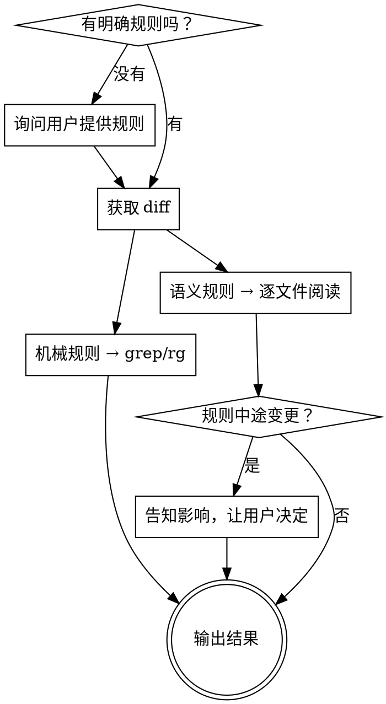

# Local Code Review

## Overview

对本地 diff 或 GitLab MR 执行规则驱动的代码评审，输出透明可追溯的结果。

**核心原则：规则先行；机械规则用工具检测，不用肉眼；任何覆盖不足必须如实声明。**

## When to Use

- 用户提供 branch/commit 对或 GitLab MR URL 要求评审
- 需要明确规则驱动（不接受隐式个人标准）
- 结果需要声明覆盖范围、跳过文件、局限性

**不适用：** 单文件 ad-hoc 问题（直接回答即可）；无 diff 的架构讨论。

## Core Pattern



## Quick Reference

| 场景 | 做法 |
|------|------|
| 无规则 | 先询问；或自选通用最佳实践并在报告中声明"规则为评审方自选" |
| 机械规则 | 必须用 grep/rg 扫描，禁止肉眼替代 |
| 文件 >20 个 | 声明优先级策略，列出跳过的文件及原因 |
| 规则中途变更 | 告知已检查文件的覆盖影响，让用户决定 A/B/C |
| 输出格式 | 默认 Markdown；仅用户明确要求时才生成 HTML 文件 |

## 获取 Diff

**本地模式：**
```bash
git diff <base>...<feature> --name-only   # 先看文件列表
git diff <base>...<feature>               # 完整 diff
```

**GitLab MR 模式：** 见 `reference/gitlab-api.md`（需设置 `GITLAB_TOKEN` 环境变量）。

**HTML 报告模板：** 见 `reference/report-template.html`（仅用户要求时使用）。

## Common Mistakes

| 借口 | 现实 |
|------|------|
| "没规则，用通用标准就行" | 必须声明自选规则清单，不得用黑盒标准 |
| "时间紧，扫一遍说没问题" | 没检查的地方不能说"无问题"，只能说"未检查" |
| "范围外问题我不管" | 顺手发现的问题放"额外发现"区块，不对用户隐瞒 |
| "机械规则读一下就行" | 人眼比 grep 更容易漏，必须用工具扫描 |
| "跳过文件没必要说" | 跳过的文件必须在报告中列出并说明原因 |
| "规则变了，悄悄补扫就行" | 必须告知已检查文件的覆盖影响，由用户决定处理方式 |
