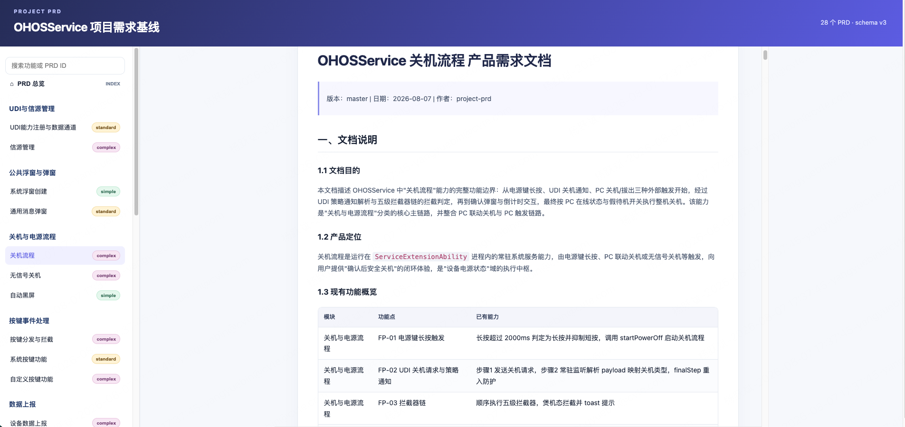
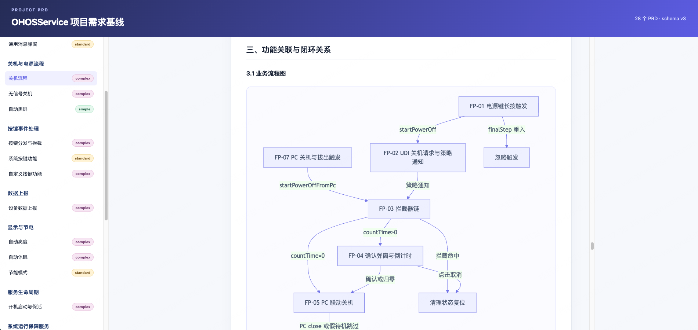

# project-prd

[](https://skills.gz.cvte.cn/skill/project-prd)
[](https://skills.gz.cvte.cn/skill/project-prd)

> ⚠️ **重要提示：`project-prd` 首次初始化会整体阅读项目源码、提炼功能边界、拆分 Feature Point 并生成逐功能 PRD，通常会消耗较多 Token，也可能持续较长时间。请根据项目规模酌情选择模型和上下文配置，提前评估并控制使用成本。**

`project-prd` 从现有项目代码中全量提炼功能，为每个细分功能生成一份受保护的 PRD，并将其作为代码修改、单元测试和 Code Review 的功能基线。

## 核心特性

- **一次性初始化**：成功初始化后再次调用会直接停止，除非先清理。
- **逐功能基线**：按功能分类和细分功能生成 PRD，并记录可追溯的源码与测试证据。
- **隔离式写作**：主代理只建立分析任务包和执行全局门禁；每份细分功能 PRD 由全新的独立子代理生成，避免所有正文堆积到主代理上下文。
- **受控变更**：PRD 与 `.project-prd` 内任意普通资源文件的新增、编辑、验证和清理由对应项目级 skill 负责，避免直接破坏基线。
- **持续更新**：`project-prd update` 只同步项目级 skill 和 runtime，不发现、迁移或登记资源，也不重建已有 PRD。
- **完整性保护**：通过 manifest、审计记录和 CI 门禁校验 PRD 基线未被绕过或篡改。
- **可审计覆盖率**：初始化结论按已覆盖细分功能数/已识别细分功能总数报告功能覆盖率，并列出未覆盖功能。
- **通用 Viewer**：`project-prd-serve` 动态读取 Markdown，以只读网页展示 PRD，不为每份 PRD 生成独立页面。

## 快速开始

在项目根目录调用：

```text
/project-prd
```

首次调用会检查项目状态并初始化 PRD 基线。若项目已经初始化，请改用：

初始化中断时，完整且未被篡改的受管现场会报告 `partial + resumable=true`，主代理从单 PRD 任务账本继续；损坏或来源不明的现场仍要求先清理。

- `project-prd-add`：新增尚不存在的特性
- `project-prd-edit`：修改已有 PRD，或受控增删改图片、附件、数据等任意资源文件
- `project-prd-verify`：验证代码修改与 PRD 的一致性
- `project-prd-clear`：清理后重新初始化
- `project-prd-serve`：启动只读网页查看服务
- `project-prd update`：将全局 skill 和 runtime 更新到已初始化项目

全局 skill 升级后，在项目根目录执行：

```bash
python3 <project-prd>/scripts/bootstrap.py update --project-root <project-root>
```

资源管理与 `bootstrap.py update` 相互独立。既有但尚未登记的资源应直接通过 `project-prd-edit update` 显式接管；脚本只为本次目标开放完整性例外，并以 `create` 语义纳入 manifest 与审计链。

运行脚本前请确认使用 Python 3.9+：

```bash
python3 --version
```

## 初始化结果

```text
<project>/
├── .project-prd/
│   ├── INDEX.md
│   ├── manifest.json
│   ├── <功能分类>/
│   │   └── <细分功能>.md
│   ├── <任意资源路径>          # 可选，受控图片、附件、数据或其他二进制文件
│   ├── .history/
│   └── tools/
├── .agents/skills/
│   ├── project-prd-edit/
│   ├── project-prd-verify/
│   ├── project-prd-clear/
│   └── project-prd-serve/
├── AGENTS.md
└── .github/workflows/project-prd-guard.yml  # GitHub 仓库
```

恰好两级的 `<功能分类>/<细分功能>.md` 保留为 PRD；其余普通文件可作为资源放在 `.project-prd` 内任意相对目录。manifest、索引、owner、初始化状态、运行时、分析过程、审计记录、输出和缓存等 project-prd 功能文件不属于资源。

## v3.1.3 变更摘要

- `project-prd-edit` 支持受控增删改 `.project-prd` 内任意普通资源文件，不再绑定 `res/` 目录或 SVG 格式。
- 资源按原始字节参与 manifest、审计哈希链、原子事务、回滚和 CI 校验，完整支持二进制内容。
- PRD 与跨目录、多类型资源可以放入同一个批量事务；既有未登记资源可由明确的编辑目标直接受控接管。
- `bootstrap.py update` 仅同步项目级 skill 与 runtime，不再发现、迁移、登记或输出任何资源信息。

## PRD 网页查看服务

初始化时会同时安装项目级 `project-prd-serve`。它只携带通用 Viewer 资源，不会为每个 PRD 生成 HTML 文件；服务启动后按请求读取当前项目的 `.project-prd` 内容。

```text
/project-prd-serve
```

服务默认监听 `127.0.0.1:8765`，支持功能分类树、PRD 搜索、Markdown 展示和基础项目统计。查看服务为只读模式，PRD 修改仍必须使用 `project-prd-edit`。

同一进程也可以重复传入 `--project-root` 来托管多个项目。此时所有项目共享同一个 baseUrl 和端口，根路径展示项目列表，项目入口为 `http://127.0.0.1:8765/<项目目录名>/`。目录重名时可使用 `--project <别名>=<项目根目录>` 显式指定入口名；单项目原有的根路径入口保持兼容。

### 实际效果

Viewer 会动态读取 PRD Markdown，并提供独立滚动的功能分类列表和文档区域；复杂流程中的 Mermaid 图也会在页面中直接渲染。

<!-- cskills 兼容：图片以内嵌 WebP 提供，避免依赖发布平台的图片文件预览路由。 -->




## v3 兼容说明

`feature-points-v3` 只用于新的初始化，不会静默改写已初始化项目里锁定的 v1/v2 runtime 和 PRD。旧工作区若要采用候选拆解、流程图、矩阵和异常证据门禁，需要用户明确调用项目内 `project-prd-clear` 后重新初始化；清理会删除原 PRD 与审计历史。
