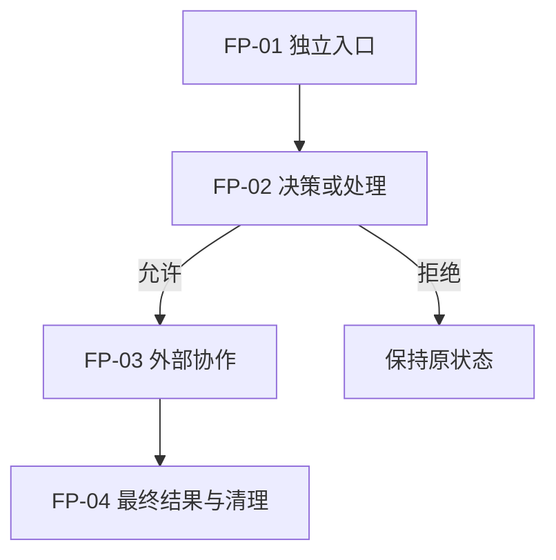

# [项目或产品名称] [细分功能名称] 产品需求文档

> 版本：[项目版本或代码基线] | 日期：[YYYY-MM-DD] | 作者：[作者]

## 一、文档说明

### 1.1 文档目的

[说明本文覆盖的完整功能边界、触发路径、流程阶段、策略和外部协作。]

### 1.2 产品定位

[说明该功能在产品中的角色、主要使用者、运行形态及其上下游。]

### 1.3 现有功能概览

| 模块 | 功能点 | 已有能力 |
|---|---|---|
| [模块 A] | FP-01 [功能点名称] | [已实现能力] |
| [模块 A] | FP-02 [功能点名称] | [已实现能力] |
| [模块 B] | FP-03 [功能点名称] | [已实现能力] |
| [模块 B] | FP-04 [功能点名称] | [已实现能力] |

### 1.4 术语表

- **[领域术语一]**：[真实定义]。
- **[领域术语二]**：[真实定义]。
- **[领域术语三]**：[真实定义]。

## 二、功能模块与功能点

> 先枚举 `decomposition_candidates`，每个 FP 恰好映射一个 trigger/stage/decision/interaction/external_wait/terminal/lifecycle 锚点，再逐个套用 `prd-writer` 完整版 7 章节。`cleanup` 可附着到对应 FP。达到数量但仍有独立候选被压缩时仍不合格。

### 模块 A：[模块名称]

#### FP-01 [功能点名称]

**1. 功能描述**

- **是什么**：[一句话定义该独立功能点]。
- **为什么**：
  - **用户痛点**：[有代码、文档或用户流证据的痛点；无证据时明确待产品确认]。
  - **业务价值**：[有证据的业务结果；无证据时明确待产品确认]。

**2. 交互逻辑**

1. [角色执行具体动作] → [系统产生具体响应]。
2. [角色触发独立分支/取消/失败] → [系统表现、恢复或清理结果]。

**3. 跳转逻辑**

| 触发操作 | 目标页面/流程 | 说明 |
|---|---|---|
| [具体操作或条件] | [页面、弹窗、流程阶段或外部系统] | [跳转结果和限制] |

> 无页面跳转时明确写“无页面跳转”，但仍需描述流程状态去向。

**4. 跳转过程逻辑**

[入口] → [校验、加载、拦截、订阅或等待] → [目标页面/状态/外部结果]。

**5. 正向限制**

| 项目 | 限制 |
|---|---|
| [允许入口/角色/状态/数值] | [具体条件、范围或时机] |

**6. 反向限制**

| 项目 | 说明 |
|---|---|
| [不允许的入口/状态/组合/重入] | [隐藏、置灰、拒绝、保持原状或清理表现] |

**7. 异常/空态/错误提示**

| 场景 | 提示内容 | 展示方式 | 源码证据 |
|---|---|---|---|
| [空态/操作失败/网络异常/权限不足/边界超限：具体场景] | [真实文案、返回或“不适用：证据”] | [Toast/弹窗/空态页/接口返回/日志/无展示] | `path/to/source:Symbol` |

---

#### FP-02 [功能点名称]

**1. 功能描述**

- **是什么**：[一句话定义]。
- **为什么**：
  - **用户痛点**：[具体内容]。
  - **业务价值**：[具体内容]。

**2. 交互逻辑**

1. [动作] → [响应]。
2. [独立分支/失败动作] → [系统结果]。

**3. 跳转逻辑**

| 触发操作 | 目标页面/流程 | 说明 |
|---|---|---|
| [条件] | [目标] | [说明] |

**4. 跳转过程逻辑**

[入口] → [中间处理] → [最终结果]。

**5. 正向限制**

| 项目 | 限制 |
|---|---|
| [项目] | [限制] |

**6. 反向限制**

| 项目 | 说明 |
|---|---|
| [项目] | [说明] |

**7. 异常/空态/错误提示**

| 场景 | 提示内容 | 展示方式 | 源码证据 |
|---|---|---|---|
| [具体异常类别和场景] | [实际表现] | [具体展示方式] | `path/to/source:Symbol` |

### 模块 B：[模块名称]

#### FP-03 [功能点名称]

> 完整重复 FP-01 的 7 个章节，不得写“同上”、不得只保留概述。

**1. 功能描述**

- **是什么**：[一句话定义]。
- **为什么**：
  - **用户痛点**：[具体内容]。
  - **业务价值**：[具体内容]。

**2. 交互逻辑**

1. [动作] → [响应]。
2. [独立分支/失败动作] → [系统结果]。

**3. 跳转逻辑**

无页面跳转；[说明状态或流程去向]。

**4. 跳转过程逻辑**

不涉及页面跳转；[入口] → [中间处理] → [最终状态]。

**5. 正向限制**

| 项目 | 限制 |
|---|---|
| [项目] | [限制] |

**6. 反向限制**

| 项目 | 说明 |
|---|---|
| [项目] | [说明] |

**7. 异常/空态/错误提示**

| 场景 | 提示内容 | 展示方式 | 源码证据 |
|---|---|---|---|
| [具体异常类别和场景] | [实际表现] | [具体展示方式] | `path/to/source:Symbol` |

---

#### FP-04 [功能点名称]

> 完整重复 7 个章节。复杂功能发现更多独立 FP 时继续 FP-05、FP-06……，不得把它们压入一个 FP 的一句话。

**1. 功能描述**

- **是什么**：[一句话定义]。
- **为什么**：
  - **用户痛点**：[具体内容]。
  - **业务价值**：[具体内容]。

**2. 交互逻辑**

1. [动作] → [响应]。
2. [独立分支/失败动作] → [系统结果]。

**3. 跳转逻辑**

| 触发操作 | 目标页面/流程 | 说明 |
|---|---|---|
| [条件] | [目标] | [说明] |

**4. 跳转过程逻辑**

[入口] → [中间处理] → [最终结果]。

**5. 正向限制**

| 项目 | 限制 |
|---|---|
| [项目] | [限制] |

**6. 反向限制**

| 项目 | 说明 |
|---|---|
| [项目] | [说明] |

**7. 异常/空态/错误提示**

| 场景 | 提示内容 | 展示方式 | 源码证据 |
|---|---|---|---|
| [具体异常类别和场景] | [实际表现] | [具体展示方式] | `path/to/source:Symbol` |

## 三、功能关联与闭环关系

### 3.1 业务流程图

`complex` PRD 必须绘制一张覆盖全部 FP 的 Mermaid 流程图：每个 FP 独立一个节点且参与同一连通流程，每条边单独一行；decision 节点至少两条带条件标签的出边。

**关键闭环链路：**

1. [闭环名称]：FP-01 [入口] → FP-02 [决策/处理] → FP-03 [协作] → FP-04 [最终结果/清理]。

- [说明每个 FP 的上游、下游、取消、失败和恢复关系。]
- 相关 PRD：[相对路径；无关联时明确写“无”]。

### 3.2 规则矩阵覆盖审计

| Matrix ID | 功能点 | 规则类型 | 源码证据 | 代码项 | PRD 覆盖项 |
|---|---|---|---|---|---|
| MX-01 | FP-02 | mapping | `path/to/source:Symbol` | [代码中的枚举/映射项 A] [代码中的枚举/映射项 B] | [PRD 中对应项 A] [PRD 中对应项 B] |

> “代码项”必须使用证据 Symbol/行号范围内真实存在的 token 或 `条件 → 结果` 表达式。确认整个 `source_entries` 行为闭包不存在可枚举规则时，才可写 MX-NONE。

## 四、行为覆盖与代码追溯

| Behavior ID | 功能点 | 源码证据 | 用户可感知行为 | PRD 章节 |
|---|---|---|---|---|
| B001 | FP-01 | `path/to/source:Symbol` | [主行为] | 交互逻辑 |
| B002 | FP-01 | `path/to/source:Symbol` | [边界或失败行为] | 反向限制 |
| B003 | FP-02 | `path/to/source:Symbol` | [主行为] | 交互逻辑 |
| B004 | FP-02 | `path/to/source:Symbol` | [策略或异常] | 异常提示 |
| B005 | FP-03 | `path/to/source:Symbol` | [主行为] | 交互逻辑 |
| B006 | FP-03 | `path/to/source:Symbol` | [协作或清理] | 功能关联与闭环关系 |
| B007 | FP-04 | `path/to/source:Symbol` | [主行为] | 交互逻辑 |
| B008 | FP-04 | `path/to/source:Symbol` | [边界或最终结果] | 反向限制 |

## 五、验证依据

- B001 → `[真实存在且符合测试命名的项目内相对测试路径]`
- B002 → 缺少自动化验证：[具体缺失范围]
- B003 → `[测试路径]`
- B004 → 缺少自动化验证：[具体缺失范围]
- B005 → `[测试路径]`
- B006 → 缺少自动化验证：[具体缺失范围]
- B007 → `[测试路径]`
- B008 → 缺少自动化验证：[具体缺失范围]
- 已知证据：[入口、路由、公开接口、数据模型、测试或文档]

## 六、已知缺口与待确认项

| 项目 | 证据位置 | 当前表现 | 影响 |
|---|---|---|---|
| [TODO/未实现策略/待产品确认项] | [真实源码或文档位置] | [当前代码实际表现] | [对用户流程的影响] |

> 确认没有缺口时写“无已知未实现项”。TODO 只能出现在本章，不能混入已实现需求正文。
