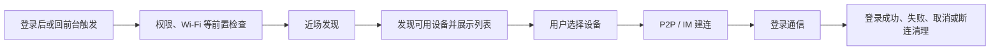
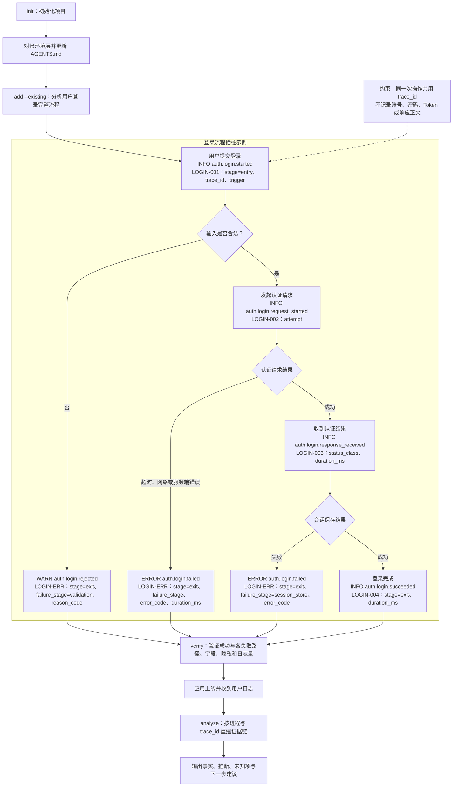

# diagnostic-logging

线上出了问题，最怕日志里只有一句“失败了”：不知道用户用的是哪个版本，也不知道流程卡在哪一步。`diagnostic-logging` 帮助 AI 在开发新功能或改造旧功能时，把日志加在真正有用的位置；上线后，还能根据用户上报的日志尽量还原问题经过。

它的目标不是让日志越多越好，而是用尽可能少的日志说清楚“什么环境下发生了什么、进行到哪一步、最后为什么结束”。Skill 可以用于多种技术栈，并为 Android/Kotlin 提供更具体的落地模板。

## 核心能力

- 初始化项目的诊断日志规范，并补齐可识别应用版本和运行环境的启动日志。
- 为新功能或指定的存量功能设计和加入能够还原业务流程的关键日志。
- 审查和整理现有日志，发现缺失、重复、不安全或过量的日志。
- 验证成功、失败、取消和重试等路径，确保日志有效且不影响业务行为。
- 分析用户上报的日志，重建问题过程并区分事实、推断和信息缺口。
- 默认支持跨平台项目，并为 Android/Kotlin 提供定制化落地指导。

## 分层理念

诊断日志按“公共上下文 → 功能会话 → 单次操作 → 关键步骤 → 最终结果”逐层提供证据，而不是让每条日志都重复携带全部信息。分析时再按进程生命周期、`feature_session_id` 和 `trace_id` 将各层拼接成一条证据链：

| 层 | 回答的问题 | 典型内容 | 打印策略 |
|---|---|---|---|
| 环境层 | 哪个应用、构建和进程产生了日志？ | 应用 ID、进程、版本、构建变体、提交号和仓库标识 | 每个进程启动时只打印一次 `runtime.process_started` / `ENV-001` |
| 会话层 | 一个持续运行、可能跨端协作的完整功能何时真正进入和退出？ | `feature_session_id`、本端/对端进入退出、断连和清理结果 | 会话开始一次、结束一次；对端发起的退出也必须闭环 |
| 操作层 | 用户或系统正在执行哪一次完整操作？ | 稳定事件名、`trace_id`、入口、终态和总耗时 | 在有明确边界的操作开始与结束处打印 |
| 检查点层 | 操作执行到了哪一步？ | 决策、状态变化、依赖请求/结果、重试和降级 | 只记录能回答诊断问题的关键边界，不记录循环或高频细节 |
| 结果与异常层 | 操作为什么成功、失败或取消？ | `result`、`error_code`、`failure_stage`、`cancellation_kind` 和耗时 | 每次操作只产生一个终态；异常堆栈只在责任边界记录一次 |

```text
ENV-001（进程环境） → feature_session_id（完整功能会话） → trace_id（会话内单次操作） → checkpoint → result/error_code
```

环境字段不应重复出现在后续功能日志中；长生命周期功能使用 `feature_session_id`，其中每次上传等子操作使用独立 `trace_id`。这样既减少日志量，也能让没有源码的 Agent 判断“哪个版本、哪个进程、哪个功能会话、哪次子操作、停在哪一步、以什么结果结束”。

### 先确认完整业务边界

AI 不能拿最先搜到的包名、类名或接口名直接当成功能边界。加日志前必须先用用户语言写出**业务能力契约**：用户要完成什么、流程从哪里开始、成功标准是什么、包含哪些前置条件和阶段、哪些结果才算真正结束。随后用**端到端旅程矩阵**列出每个阶段及阶段交接；边界仍有多种解释时，先向用户确认，不能默认只改最窄的代码模块。

例如“近场登录”不是只有登录通信：



Skill 必须同时检查“近场发现 → 设备选择”和“设备选择 → 登录通信”两个关键交接，并用外层 `feature_session_id` 关联完整业务旅程。发现和登录可以各自拥有独立 `trace_id`，但其中任一子操作结束都不能代替整个近场登录功能的终态。扫描回调属于高频路径，只记录开始/停止、状态变化、有界数量、超时和交接结果，不逐设备、逐轮扫描打印。

### 埋点完整性门禁

加入日志前，AI 必须先判断观测对象是“完整功能会话”还是“会话内单次操作”。单次操作要列出正常完成、提前返回、失败、超时、取消、回调结束和重试耗尽；只要打印了操作开始日志，每条退出路径就必须使用同一个 `trace_id` 打印且只打印一次 `stage=exit` 终态。

跨页面、进程、设备或参与方持续存在的功能还必须建立 **Feature-session Lifecycle Matrix**，覆盖本端进入、通知对端进入、会话激活、本端主动退出并通知对端、对端主动退出并通知本端、断连/销毁，以及双方同时退出的竞态。上传成功、图片展示完成或一次批注完成只是内部操作，不能当作整个功能会话已经退出。

例如拍照上传联动 PC 展示与批注时，至少需要证明两条完整路径：`App 退出 → 通知 PC → App 清理 → 会话终态`，以及 `PC 退出通知 → App 清理 → 会话终态`。两条路径竞争时，同一个 `feature_session_id` 仍只能有一条 `scope=feature_session, stage=exit` 终态。Skill 会逐项验证两个矩阵；存在“只有进入、没有退出”、把子操作结束误认为会话退出、遗漏任一端退出通知，或同一会话打印多个终态时，`add` 和 `verify` 都必须报告未完成。

## 简单示例

假设需要为存量的“用户登录”功能补充诊断日志，并在上线后根据用户上报的日志定位失败原因：

```text
$diagnostic-logging init /path/to/project
$diagnostic-logging add 用户登录 --existing
$diagnostic-logging verify 用户登录
$diagnostic-logging analyze /path/to/logs --feature auth.login
```



图中的事件名、检查点和字段是示例，实际接入时应结合现有代码与日志复用或调整。每次登录只产生一条终态事件：`auth.login.succeeded`、`auth.login.rejected` 或 `auth.login.failed`。这个流程会先保证每个进程启动时存在一次完整的环境事件，再围绕登录操作建立可关联的检查点；分析阶段即使没有源码，也能判断发生问题的应用版本、进程、操作阶段、最后成功检查点和大致故障边界。

## 插桩安全门禁

日志是可丢失的诊断证据，业务行为不是。增加埋点前，AI 必须建立 **Instrumentation Safety Contract** 和 **Behavior Preservation Matrix**，记录原流程的返回值、状态变化、调用/回调顺序、异常和取消语义，以及日志字段的计算成本。插桩后要逐项证明这些行为保持不变。

验证必须覆盖日志关闭、正常开启，以及故障注入场景：`isEnabled`、字段构造或日志输出主动抛出异常时，业务仍应得到与未插桩前完全相同的结果、状态、调用次数/顺序、异常类型和取消传播。日志故障只能导致该条诊断证据丢失，不能导致崩溃、把业务成功改成失败、吞掉原异常或改变重试和回调。

性能风险同样是阻断项：日志字段只允许惰性构造、有界标量和 O(1) 计算；不得为日志新增网络、文件、数据库、IPC、线程、协程、定时器、等待或重试，也不得序列化完整对象、遍历集合、反射或在高频路径逐次打印。缺少故障注入或必要性能证据时，`add` 和 `verify` 都不能给出完成结论。

## 安全边界

- 不在逐帧渲染、音视频采样、传感器回调、高频轮询、紧密循环或批量逐项处理中逐次打印日志。
- 高频路径确需证据时，只允许在热路径外使用有界聚合、状态变化、采样或明确限频。
- 不记录 Token、Cookie、认证 Header、请求响应正文、用户内容、设备唯一标识或完整对象序列化结果。
- 同一异常只在责任边界记录一次堆栈。
- 环境信息只出现在进程启动事件中，后续功能日志不重复携带；仓库字段不得泄露本机绝对路径、工作区路径或凭据。
- 日志不得改变业务控制流、时序、状态、返回值、取消或异常传播。
- 不擅自引入日志框架、采集上传、轮转、加密、保留策略、看板或服务端链路基础设施。

## 快速命令

在 Codex 中使用 `$diagnostic-logging <command>`：

| 命令 | 用途 |
|---|---|
| `$diagnostic-logging help` | 显示命令和必填参数，不修改任何内容 |
| `$diagnostic-logging init [项目目录]` | 对账环境层并初始化 `AGENTS.md` 规则 |
| `$diagnostic-logging env [项目目录]` | 只对账和验证环境层 |
| `$diagnostic-logging add <功能> [--new\|--existing]` | 为新功能或指定存量功能加入日志 |
| `$diagnostic-logging review <功能>` | 对账环境层后，只审查功能日志覆盖 |
| `$diagnostic-logging verify <功能>` | 对账环境层后，验证插桩、事件序列、隐私和日志量 |
| `$diagnostic-logging analyze <日志路径> [--feature <前缀>]` | 只读分析上报日志，不修改源码 |

两者关系可以直接理解为：

```text
init = env + 初始化或升级 AGENTS.md 受管规则
```

- 项目首次接入或需要升级项目规则时使用 `init`。
- 只想检查、补齐或验证 `runtime.process_started` / `ENV-001` 时使用 `env`。
- 两者都不会为具体业务功能增加日志；`init` 的规则写入和 `env` 的环境层对账都是幂等的。

没有显式命令时，AI 只在意图明确时自动路由，并先报告选择的命令；存在歧义时显示 `help`，不把多个流程静默混合。`add --new` 映射原 `new-development` 模式，`add --existing` 映射原 `existing-feature` 模式。

`init`、`env`、`add`、`review` 和 `verify` 先执行环境层期望状态对账。`help` 与 `analyze` 是只读例外：分析已上报日志时，缺少 `ENV-001` 应报告为证据缺口，不能借此修改项目源码。

环境层对账不依赖上次的检查结果、初始化标记、类名或日志事件名；它会重新枚举当前可执行目标、variant、进程和入口，并追踪它们是否到达中央 reporter。完整实现直接复用；已有但不完整的实现原地升级；不存在时添加一个中央实现；发现重复实现时合并去重。

## 环境层约定

| 问题 | 约定 |
|---|---|
| 打印什么 | 应用名、应用 ID/包名、当前进程名、版本名、版本号、flavor、buildType、提交号、分支和脱敏后的仓库标识 |
| 何时添加 | 每次使用 Skill 都从当前结构重新对账；缺失则添加，不完整则补齐，重复则合并 |
| 何时打印 | 现有日志器就绪后的进程启动阶段；主进程和每个子进程各打印一次 |
| 是否重复 | 中央 reporter 使用进程内线程安全 once guard；后续功能日志不再携带环境字段 |
| 内容是否固定 | 字段名、类型、来源、回退值和脱敏规则由模板固定；实际值由构建系统、CI、打包元数据和当前进程自动生成 |

跨平台模板把全部环境字段统一为字符串，固定事件名 `runtime.process_started` 和检查点 `ENV-001`。Android 模板使用 `BuildConfig` 与 Gradle/CI 固化版本和仓库信息，运行时只解析打包应用名及当前进程名。仓库字段表示 `host/owner/repository`，不是本机 Git 目录。

### 环境层具体包含哪些信息

以 Android 应用的一个 `:sync` 子进程为例，环境层包含以下四组信息：

| 信息组 | 字段 | 示例 | 说明与来源 |
|---|---|---|---|
| 事件标识 | `event`、`checkpoint`、`module`、`stage`、`result` | `runtime.process_started`、`ENV-001`、`runtime`、`process_start`、`started` | 固定模板，用于识别这是一条进程启动环境事件 |
| 应用信息 | `app_name`、`app_id`、`process_name` | `Example App`、`com.example.app`、`com.example.app:sync` | 应用名和包名来自打包元数据；运行时解析当前主进程或子进程名称 |
| 版本信息 | `version_name`、`version_code`、`build_flavor`、`build_type` | `3.2.1`、`30201`、`production`、`release` | 由 Gradle、BuildConfig 或 CI 在编译时固化 |
| 仓库信息 | `vcs_commit`、`vcs_branch`、`vcs_repository` | `012345...`、`main`、`example.com/team/app` | 提交号、审核后的分支名和脱敏仓库标识由 CI 或 Git 在编译时固化 |

这里的 `vcs_repository` 表示类似 `host/owner/repository` 的仓库身份。例如 `git@example.com:team/app.git` 应转换为 `example.com/team/app`；它不是本机的 `.git` 目录、工作区绝对路径或包含凭据的远端 URL。

以上信息组合成一条结构化日志如下。它只展示字段形状，实际值必须自动生成，不能把示例值手工写入业务源码：

```json
{
  "event": "runtime.process_started",
  "checkpoint": "ENV-001",
  "module": "runtime",
  "stage": "process_start",
  "result": "started",
  "app_name": "Example App",
  "app_id": "com.example.app",
  "process_name": "com.example.app:sync",
  "version_name": "3.2.1",
  "version_code": "30201",
  "build_flavor": "production",
  "build_type": "release",
  "vcs_commit": "0123456789abcdef0123456789abcdef01234567",
  "vcs_branch": "main",
  "vcs_repository": "example.com/team/app"
}
```

主进程和每个子进程各自打印一次；同一进程中即使多个入口重复调用 reporter，也会由线程安全的 once guard 去重。后续的 `auth.login.*` 等功能日志只携带自身的 `trace_id`、检查点和结果字段，不再重复版本、构建或仓库信息。

为避免漂移，Skill 还要求复用项目现有测试/构建能力加入三类保护：字段与 once 行为契约测试、启动挂载测试、根据当前打包入口生成的进程覆盖检查。因此手动删除调用会使验证失败，新增或修改进程也会被重新纳入覆盖矩阵；若项目无法自动化验证，则必须明确记录风险，不能沿用历史 `complete` 状态。

## 日志分析

通过 Skill 命令提交日志：

```text
$diagnostic-logging analyze <日志文件或目录> [--feature <可选事件前缀>]
```

Skill 会在内部提取结构化证据，识别整行 JSON 或日志前缀后的 JSON，按 `runtime.process_started`、PID、进程会话和 `trace_id` 重建证据，并报告字段缺失、显式失败、取消和没有终态的 trace。它只输出允许字段，不复制请求响应正文或任意原始内容，也不直接宣称根因。

AI 随后按照“已观察事实、带置信度的推断、未知项”输出诊断报告。有源码时只围绕证据做定点分析；没有源码时可以判断应用版本、进程、失败操作、最后检查点和大致故障边界，但不能声称已经定位到具体代码行。

## 初始化项目约束

通过 Skill 命令初始化目标项目：

```text
$diagnostic-logging init <项目根目录>
```

初始化器只管理 `AGENTS.md` 中带有以下标记的规则块：

```text
DIAGNOSTIC_LOGGING_RULES_START
DIAGNOSTIC_LOGGING_RULES_END
```

它会保留项目原有内容，并返回：

- `created`：新建了 `AGENTS.md`；
- `updated`：新增或升级了受管规则块；
- `unchanged`：规则已经是最新状态。

如果项目存在单数形式的 `AGENT.md`，初始化器不会修改它，而会给出提示并使用 Codex 标准的 `AGENTS.md`。

## AI 执行产物

一次完整执行应至少提供：

1. **Environment Bootstrap Result**：环境层现状分类、证据、复用或修改决定、构建时数据来源和一次性打印验证。
2. **Business Capability Contract**：用用户语言定义目标、入口、成功标准、前置条件、阶段、终态和排除项。
3. **End-to-End Journey Matrix**：列出所有业务阶段、关键交接、当前日志覆盖与验证方式。
4. **Instrumentation Safety Contract / Behavior Preservation Matrix**：定义业务不变量、日志故障边界、性能成本和故障注入场景。
5. **Observability Plan**：功能边界、关键路径、异步与外部依赖边界、隐私和日志量判断。
6. **Checkpoint Manifest**：稳定事件名、检查点、字段、等级及预期事件序列。
7. **Feature-session Lifecycle Matrix（适用时）**：列出完整功能会话的本端/对端进入退出、通知结果、清理、竞态及 `feature_session_id` 归属。
8. **Exit-path Matrix**：列出每个单次操作的应用可控退出路径、对应终态、`trace_id` 归属和验证方式。
9. **代码与测试**：只修改环境层、指定功能及最小必要的共享日志适配层。
10. **Verification Report / Instrumentation Safety Report**：汇总功能覆盖、行为等价、故障注入、性能、隐私、缺口及主动跳过的高频路径。

业务边界发现见 [references/business-boundary-discovery.md](references/business-boundary-discovery.md)，插桩安全规则见 [references/instrumentation-safety.md](references/instrumentation-safety.md)，环境字段与幂等规则见 [references/environment-layer.md](references/environment-layer.md)，完整方法论见 [references/methodology.md](references/methodology.md)，跨端会话规则见 [references/feature-session-lifecycle.md](references/feature-session-lifecycle.md)，Android/Kotlin 落地方式见 [references/android-kotlin.md](references/android-kotlin.md)。

## 目录结构

```text
diagnostic-logging/
├── SKILL.md
├── README.md
├── agents/openai.yaml
├── assets/agents-rules.md
├── references/
│   ├── business-boundary-discovery.md
│   ├── environment-layer.md
│   ├── feature-session-lifecycle.md
│   ├── instrumentation-safety.md
│   ├── log-analysis.md
│   ├── methodology.md
│   └── android-kotlin.md
├── scripts/
│   ├── analyze_log.py
│   └── init_project.py
└── tests/
    ├── test_analyze_log.py
    ├── test_init_project.py
    └── test_skill_contract.py
```
