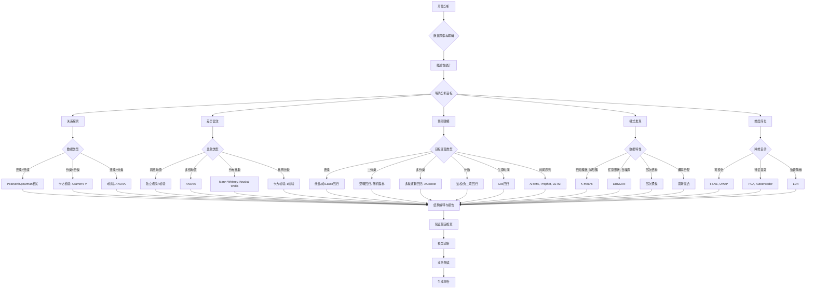

# 统计方法选择指南

## 目录
1. [描述性统计](#描述性统计)
2. [推断性统计](#推断性统计)
3. [相关性分析](#相关性分析)
4. [回归分析](#回归分析)
5. [时间序列分析](#时间序列分析)
6. [分类分析](#分类分析)
7. [聚类分析](#聚类分析)
8. [降维方法](#降维方法)
9. [方法选择流程图](#方法选择流程图)

## 描述性统计

### 1.1 集中趋势度量
| 方法 | 适用场景 | 优点 | 缺点 | Python代码 |
|------|----------|------|------|------------|
| **均值** | 数据分布对称，无异常值 | 充分利用所有数据 | 对异常值敏感 | `df.mean()` |
| **中位数** | 数据偏斜或有异常值 | 对异常值稳健 | 忽略数据分布信息 | `df.median()` |
| **众数** | 分类数据或寻找最常见值 | 适用于所有数据类型 | 可能不唯一，对样本量敏感 | `df.mode()` |
| **加权均值** | 不同观测重要性不同 | 考虑权重信息 | 需要权重信息 | `np.average(values, weights=weights)` |

### 1.2 离散程度度量
| 方法 | 适用场景 | 解释 |
|------|----------|------|
| **方差/标准差** | 数据分布对称 | 测量数据点与均值的平均偏差 |
| **四分位距(IQR)** | 数据偏斜或有异常值 | Q3-Q1，中间50%数据的范围 |
| **极差** | 快速了解数据范围 | 最大值-最小值，受异常值影响大 |
| **变异系数** | 比较不同尺度数据的离散程度 | 标准差/均值，无量纲 |
| **平均绝对偏差** | 对异常值比标准差更稳健 | 绝对偏差的平均值 |

### 1.3 分布形状度量
| 方法 | 计算公式 | 解释 |
|------|----------|------|
| **偏度** | $g_1 = \frac{\mu_3}{\sigma^3}$ | >0右偏，<0左偏，=0对称 |
| **峰度** | $g_2 = \frac{\mu_4}{\sigma^4} - 3$ | >0尖峰，<0平峰，=0正态 |
| **分位数** | 第p百分位数 | 数据分布的特定位置 |

## 推断性统计

### 2.1 假设检验选择表
| 检验类型 | 数据要求 | 检验目的 | Python函数 |
|----------|----------|----------|------------|
| **单样本t检验** | 连续数据，正态分布 | 样本均值是否等于特定值 | `scipy.stats.ttest_1samp` |
| **独立样本t检验** | 两组独立连续数据，正态，方差齐性 | 两组均值是否相等 | `scipy.stats.ttest_ind` |
| **配对样本t检验** | 配对连续数据，差值正态 | 配对观测均值是否相等 | `scipy.stats.ttest_rel` |
| **单样本z检验** | 大样本(n>30)，已知总体方差 | 样本均值是否等于特定值 | 手动计算 |
| **方差分析(ANOVA)** | 多组连续数据，正态，方差齐性 | 多组均值是否相等 | `scipy.stats.f_oneway` |
| **卡方检验** | 分类数据，期望频数>5 | 观察频数与期望频数差异 | `scipy.stats.chisquare` |
| **卡方独立性检验** | 列联表数据 | 两个分类变量是否独立 | `scipy.stats.chi2_contingency` |
| **Mann-Whitney U检验** | 两组独立数据，不满足正态 | 两组分布是否相同 | `scipy.stats.mannwhitneyu` |
| **Wilcoxon符号秩检验** | 配对数据，不满足正态 | 配对观测中位数是否相等 | `scipy.stats.wilcoxon` |
| **Kruskal-Wallis检验** | 多组独立数据，不满足正态 | 多组分布是否相同 | `scipy.stats.kruskal` |
| **Friedman检验** | 多组配对数据，不满足正态 | 多组配对分布是否相同 | `scipy.stats.friedmanchisquare` |

### 2.2 检验假设检查清单
1. **正态性检验**
   - Shapiro-Wilk检验：`scipy.stats.shapiro` (n<50)
   - Kolmogorov-Smirnov检验：`scipy.stats.kstest` (n>50)
   - QQ图：视觉检查
   - 偏度峰度检验：`scipy.stats.normaltest`

2. **方差齐性检验**
   - Levene检验：`scipy.stats.levene` (对异常值稳健)
   - Bartlett检验：`scipy.stats.bartlett` (要求正态分布)
   - Fligner-Killeen检验：`scipy.stats.fligner` (非参数)

3. **样本独立性检查**
   - 实验设计：随机抽样/分配
   - 数据收集过程审查
   - 避免重复测量或相关样本

### 2.3 p值解释指南
| p值范围 | 证据强度 | 结论表述 |
|---------|----------|----------|
| p < 0.001 | 极强证据 | 有极显著差异 |
| 0.001 ≤ p < 0.01 | 强证据 | 有显著差异 |
| 0.01 ≤ p < 0.05 | 中等证据 | 有差异 |
| 0.05 ≤ p < 0.1 | 弱证据 | 可能有差异，需要更多数据 |
| p ≥ 0.1 | 无证据 | 无显著差异 |

**注意**：p值不是效应大小的度量，需要同时报告效应大小和置信区间。

## 相关性分析

### 3.1 相关系数选择表
| 相关系数 | 数据类型 | 测量关系 | 范围 | 对异常值敏感性 | Python函数 |
|----------|----------|----------|------|----------------|------------|
| **Pearson r** | 连续，线性，正态 | 线性关系 | [-1, 1] | 敏感 | `df.corr(method='pearson')` |
| **Spearman ρ** | 连续/有序，单调 | 单调关系 | [-1, 1] | 稳健 | `df.corr(method='spearman')` |
| **Kendall τ** | 连续/有序，单调 | 一致对比例 | [-1, 1] | 稳健 | `df.corr(method='kendall')` |
| **点二列相关** | 二分×连续 | 两组均值差异 | [-1, 1] | 中等 | `scipy.stats.pointbiserialr` |
| **Phi系数** | 二分×二分 | 关联强度 | [-1, 1] | 中等 | 手动计算 |
| **Cramer's V** | 分类×分类 | 关联强度 | [0, 1] | 中等 | `scipy.stats.contingency.association` |

### 3.2 相关性解释指南
| |r|值 | 解释强度 | 方差解释比例 |
|---|--|----|----------|--------------|
| 0.00-0.10 | 无相关 | 0-1% |
| 0.10-0.30 | 弱相关 | 1-9% |
| 0.30-0.50 | 中等相关 | 9-25% |
| 0.50-0.70 | 强相关 | 25-49% |
| 0.70-0.90 | 很强相关 | 49-81% |
| 0.90-1.00 | 极强相关 | 81-100% |

### 3.3 相关性分析注意事项
1. **相关≠因果**：相关性不能证明因果关系
2. **样本量要求**：小样本可能产生虚假相关
3. **异常值影响**：异常值可能扭曲相关系数
4. **非线性关系**：线性相关系数可能低估非线性关系
5. **范围限制**：数据范围受限时可能低估相关
6. **多重比较**：进行多个相关检验时调整p值

## 回归分析

### 4.1 回归模型选择表
| 模型类型 | 因变量类型 | 自变量类型 | 适用场景 | Python实现 |
|----------|------------|------------|----------|------------|
| **线性回归** | 连续 | 连续/分类 | 预测连续值 | `sklearn.linear_model.LinearRegression` |
| **逻辑回归** | 二分 | 连续/分类 | 分类概率 | `sklearn.linear_model.LogisticRegression` |
| **多项式回归** | 连续 | 连续 | 非线性关系 | `sklearn.preprocessing.PolynomialFeatures` |
| **岭回归** | 连续 | 多重共线性 | 正则化，防止过拟合 | `sklearn.linear_model.Ridge` |
| **Lasso回归** | 连续 | 特征选择 | 稀疏解，自动特征选择 | `sklearn.linear_model.Lasso` |
| **弹性网络** | 连续 | 综合需求 | Ridge+Lasso组合 | `sklearn.linear_model.ElasticNet` |
| **泊松回归** | 计数 | 连续/分类 | 计数数据建模 | `statsmodels.GLM(family=Poisson())` |
| **负二项回归** | 过离散计数 | 连续/分类 | 计数数据，方差>均值 | `statsmodels.GLM(family=NegativeBinomial())` |
| **Cox回归** | 生存时间 | 连续/分类 | 生存分析 | `lifelines.CoxPHFitter` |

### 4.2 回归诊断检查清单
1. **线性关系**：残差与拟合值散点图应随机分布
2. **独立性**：Durbin-Watson检验 (≈2表示独立)
3. **正态性**：残差的QQ图，Shapiro-Wilk检验
4. **同方差性**：Breusch-Pagan检验，残差图
5. **多重共线性**：VIF值<10，条件指数<30
6. **异常值检测**：Cook距离，杠杆值，学生化残差
7. **影响点检测**：DFFITS，DFBETAS

### 4.3 模型评估指标
| 指标 | 公式 | 解释 | 适用模型 |
|------|------|------|----------|
| **R²** | $1 - \frac{SS_{res}}{SS_{tot}}$ | 解释的方差比例 | 线性回归 |
| **调整R²** | $1 - \frac{(1-R^2)(n-1)}{n-p-1}$ | 考虑变量数的R² | 线性回归 |
| **AIC** | $2k - 2\ln(L)$ | 模型拟合与复杂度平衡 | 所有模型 |
| **BIC** | $\ln(n)k - 2\ln(L)$ | 比AIC更惩罚复杂度 | 所有模型 |
| **MSE/RMSE** | $\frac{1}{n}\sum(y_i-\hat{y}_i)^2$ | 预测误差 | 连续预测 |
| **MAE** | $\frac{1}{n}\sum|y_i-\hat{y}_i|$ | 平均绝对误差 | 连续预测 |
| **对数似然** | $\sum\ln f(y_i|\theta)$ | 模型拟合优度 | 概率模型 |
| **准确率** | $\frac{TP+TN}{Total}$ | 正确分类比例 | 分类模型 |
| **精确率** | $\frac{TP}{TP+FP}$ | 正类预测准确性 | 分类模型 |
| **召回率** | $\frac{TP}{TP+FN}$ | 正类识别完整性 | 分类模型 |
| **F1分数** | $2\times\frac{Precision\times Recall}{Precision+Recall}$ | 精确率与召回率调和平均 | 分类模型 |
| **AUC-ROC** | ROC曲线下面积 | 分类器整体性能 | 分类模型 |

## 时间序列分析

### 5.1 时间序列模型选择表
| 模型 | 适用场景 | 数据要求 | 关键参数 | Python实现 |
|------|----------|----------|----------|------------|
| **移动平均(MA)** | 平滑短期波动 | 平稳 | 窗口大小 | `pandas.DataFrame.rolling` |
| **指数平滑(ES)** | 趋势和季节性 | 任意 | 平滑系数α,β,γ | `statsmodels.tsa.holtwinters` |
| **AR模型** | 自相关序列 | 平稳 | 阶数p | `statsmodels.tsa.ar_model.AutoReg` |
| **MA模型** | 移动平均过程 | 平稳 | 阶数q | `statsmodels.tsa.arima.model.ARIMA` |
| **ARIMA模型** | 非平稳序列 | 可差分平稳 | p,d,q | `statsmodels.tsa.arima.model.ARIMA` |
| **SARIMA模型** | 季节性序列 | 季节性平稳 | P,D,Q,s | `statsmodels.tsa.statespace.SARIMAX` |
| **Prophet** | 多季节性，节假日 | 日粒度 | 季节性参数 | `prophet.Prophet` |
| **LSTM** | 复杂非线性模式 | 大量数据 | 隐藏层，时间步 | `tensorflow.keras.layers.LSTM` |

### 5.2 时间序列分析步骤
1. **可视化**：绘制时间序列图，识别趋势、季节性、异常值
2. **平稳性检验**：ADF检验、KPSS检验、差分处理
3. **季节性分解**：使用`statsmodels.tsa.seasonal.seasonal_decompose`
4. **自相关分析**：ACF和PACF图确定模型阶数
5. **模型拟合**：根据ACF/PACF选择ARIMA(p,d,q)参数
6. **模型诊断**：残差检验（白噪声检验）
7. **预测评估**：使用滚动窗口或时间序列交叉验证

### 5.3 平稳性检验方法
| 检验 | 原假设 | Python函数 | 判断标准 |
|------|--------|------------|----------|
| **ADF检验** | 序列有单位根（非平稳） | `statsmodels.tsa.stattools.adfuller` | p<0.05则平稳 |
| **KPSS检验** | 序列平稳 | `statsmodels.tsa.stattools.kpss` | p>0.05则平稳 |
| **PP检验** | 序列有单位根 | `statsmodels.tsa.stattools.phillipsperron` | p<0.05则平稳 |
| **目视检查** | 均值、方差、自相关恒定 | 时间序列图 | 无明显趋势/季节性 |

## 分类分析

### 6.1 分类算法选择表
| 算法 | 适用场景 | 优点 | 缺点 | Python实现 |
|------|----------|------|------|------------|
| **逻辑回归** | 线性可分，概率输出 | 可解释，计算快 | 只能处理线性关系 | `sklearn.linear_model.LogisticRegression` |
| **决策树** | 非线性关系，可解释性 | 无需特征缩放，可解释 | 容易过拟合 | `sklearn.tree.DecisionTreeClassifier` |
| **随机森林** | 高维数据，稳健 | 抗过拟合，特征重要性 | 计算成本高，黑箱 | `sklearn.ensemble.RandomForestClassifier` |
| **GBDT** | 预测精度要求高 | 高精度，灵活 | 容易过拟合，调参复杂 | `sklearn.ensemble.GradientBoostingClassifier` |
| **XGBoost** | 大规模数据，竞赛 | 速度快，精度高 | 调参复杂，内存消耗大 | `xgboost.XGBClassifier` |
| **LightGBM** | 超大规模数据 | 极快，内存效率高 | 对小数据集可能过拟合 | `lightgbm.LGBMClassifier` |
| **SVM** | 小样本，高维空间 | 理论完备，泛化好 | 对参数敏感，计算慢 | `sklearn.svm.SVC` |
| **KNN** | 简单基准，小数据集 | 简单，无需训练 | 计算慢，维度灾难 | `sklearn.neighbors.KNeighborsClassifier` |
| **朴素贝叶斯** | 文本分类，高维 | 计算快，小样本有效 | 特征独立性假设强 | `sklearn.naive_bayes` |
| **神经网络** | 复杂模式，大量数据 | 强大表示能力 | 需要大量数据，调参复杂 | `tensorflow.keras` |

### 6.2 类别不平衡处理
| 方法 | 类型 | 适用场景 | Python实现 |
|------|------|----------|------------|
| **重采样** | 过采样/欠采样 | 中度不平衡 | `imblearn.over_sampling.SMOTE` |
| **类别权重** | 算法级别 | 支持权重的算法 | `class_weight='balanced'` |
| **阈值移动** | 后处理 | 概率输出模型 | 调整分类阈值 |
| **集成方法** | 算法组合 | 严重不平衡 | `imblearn.ensemble.BalancedRandomForest` |
| **评估指标调整** | 指标选择 | 所有情况 | 使用F1、AUC而非准确率 |

### 6.3 分类评估指标选择
| 场景 | 推荐指标 | 原因 |
|------|----------|------|
| **平衡数据** | 准确率 | 直观，易于解释 |
| **不平衡数据** | F1分数，AUC-ROC | 不受类别分布影响 |
| **代价敏感** | 代价矩阵 | 考虑不同错误类型的代价 |
| **概率校准** | Brier分数，对数损失 | 评估概率预测质量 |
| **多分类** | 宏平均/微平均F1 | 综合评估多类别性能 |

## 聚类分析

### 7.1 聚类算法选择表
| 算法 | 适用场景 | 优点 | 缺点 | Python实现 |
|------|----------|------|------|------------|
| **K-means** | 球形簇，相似大小 | 简单，高效 | 需指定k，对异常值敏感 | `sklearn.cluster.KMeans` |
| **层次聚类** | 任意形状，树状结构 | 无需指定k，可视化好 | 计算复杂度高 | `sklearn.cluster.AgglomerativeClustering` |
| **DBSCAN** | 任意形状，噪声数据 | 无需指定k，抗噪声 | 对参数敏感，密度不均问题 | `sklearn.cluster.DBSCAN` |
| **谱聚类** | 非凸形状，图数据 | 能发现复杂结构 | 计算成本高，需指定k | `sklearn.cluster.SpectralClustering` |
| **高斯混合** | 椭球簇，概率分配 | 软聚类，概率模型 | 假设高斯分布，可能过拟合 | `sklearn.mixture.GaussianMixture` |
| **均值漂移** | 任意形状，自动确定k | 自动确定簇数 | 计算慢，带宽参数敏感 | `sklearn.cluster.MeanShift` |
| **OPTICS** | 密度不均，层次信息 | DBSCAN改进，处理密度变化 | 计算更复杂 | `sklearn.cluster.OPTICS` |

### 7.2 聚类质量评估
| 评估类型 | 指标 | 有标签 | 解释 | Python函数 |
|----------|------|--------|------|------------|
| **内部指标** | 轮廓系数 | 否 | [-1,1]，越大越好 | `sklearn.metrics.silhouette_score` |
| | Calinski-Harabasz指数 | 否 | 越大越好，类间方差/类内方差 | `sklearn.metrics.calinski_harabasz_score` |
| | Davies-Bouldin指数 | 否 | 越小越好，簇间相似度 | `sklearn.metrics.davies_bouldin_score` |
| **外部指标** | 调整兰德指数 | 是 | [-1,1]，考虑随机性 | `sklearn.metrics.adjusted_rand_score` |
| | 互信息 | 是 | [0,1]，信息论度量 | `sklearn.metrics.adjusted_mutual_info_score` |
| | 同质性完整性V-measure | 是 | [0,1]，平衡同质性和完整性 | `sklearn.metrics.homogeneity_completeness_v_measure` |

### 7.3 聚类预处理步骤
1. **特征标准化**：`StandardScaler`或`MinMaxScaler`
2. **降维处理**：PCA或t-SNE用于可视化
3. **距离度量选择**：欧氏距离、曼哈顿距离、余弦相似度
4. **确定k值**：肘部法则、轮廓系数、间隙统计
5. **结果解释**：簇中心分析、特征重要性

## 降维方法

### 8.1 降维技术选择表
| 方法 | 适用场景 | 优点 | 缺点 | Python实现 |
|------|----------|------|------|------------|
| **PCA** | 线性关系，连续数据 | 最大化方差，去相关 | 线性假设，可解释性差 | `sklearn.decomposition.PCA` |
| **t-SNE** | 可视化，高维数据 | 保持局部结构，可视化好 | 计算慢，不能用于新数据 | `sklearn.manifold.TSNE` |
| **UMAP** | 可视化，大规模数据 | 比t-SNE快，保持全局结构 | 参数敏感，可解释性差 | `umap.UMAP` |
| **LDA** | 有监督，分类问题 | 最大化类间分离 | 需要标签，线性假设 | `sklearn.discriminant_analysis.LinearDiscriminantAnalysis` |
| **Isomap** | 非线性流形 | 保持测地距离 | 计算复杂度高 | `sklearn.manifold.Isomap` |
| **LLE** | 非线性，局部线性 | 保持局部几何结构 | 对噪声敏感 | `sklearn.manifold.LocallyLinearEmbedding` |
| **Autoencoder** | 复杂非线性关系 | 强大表示能力 | 需要大量数据，训练复杂 | `tensorflow.keras` |

### 8.2 降维应用场景
1. **可视化**：高维数据降至2-3维，使用t-SNE或UMAP
2. **特征提取**：从原始特征创建新特征，使用PCA或Autoencoder
3. **去噪**：去除噪声成分，使用PCA
4. **数据压缩**：减少存储和计算成本，使用PCA
5. **多重共线性处理**：消除相关特征，使用PCA
6. **监督学习预处理**：减少特征维度，提高模型性能

### 8.3 主成分数量选择
| 方法 | 原理 | Python实现 |
|------|------|------------|
| **累积方差解释率** | 保留足够方差（如95%） | `pca.explained_variance_ratio_.cumsum()` |
| **肘部法则** | 特征值下降拐点 | 绘制特征值或解释方差 |
| **Kaiser准则** | 保留特征值>1的成分 | `pca.explained_variance_ > 1` |
| **平行分析** | 与随机数据比较 | 需要模拟 |
| **交叉验证** | 基于下游任务性能 | 网格搜索最佳n_components |

## 方法选择流程图

## 总结要点

1. **问题驱动**：统计方法选择应由业务问题驱动，而非技术偏好
2. **假设检查**：任何统计方法都有假设，使用前必须验证
3. **多重验证**：使用多种方法交叉验证结果
4. **效应大小**：除了统计显著性，必须报告效应大小和置信区间
5. **可视化先行**：在应用复杂方法前，先进行充分的可视化探索
6. **循序渐进**：从简单方法开始，必要时再使用复杂方法
7. **可解释性**：在精度和可解释性之间取得平衡
8. **持续学习**：统计学方法不断发展，保持学习和更新

## 常见错误与避免方法

| 常见错误 | 后果 | 避免方法 |
|----------|------|----------|
| **忽略假设检验** | 结果无效 | 使用前进行正态性、方差齐性等检验 |
| **p值误解** | 错误结论 | 理解p值的真正含义，结合效应大小 |
| **多重比较问题** | 假阳性增加 | 使用Bonferroni、FDR等方法校正 |
| **数据窥探** | 过拟合 | 使用交叉验证，分离训练集和测试集 |
| **忽略异常值** | 结果偏差 | 进行异常值检测和处理 |
| **相关当作因果** | 逻辑错误 | 设计实验或使用因果推断方法 |
| **样本量不足** | 低统计功效 | 进行功效分析确定所需样本量 |
| **忽略数据分布** | 方法不当 | 充分探索数据分布特征 |

---

**最后更新**：2026年5月29日  
**适用版本**：Python 3.8+，scikit-learn 1.0+，statsmodels 0.13+  
**维护建议**：定期检查各库版本更新，关注新方法和最佳实践